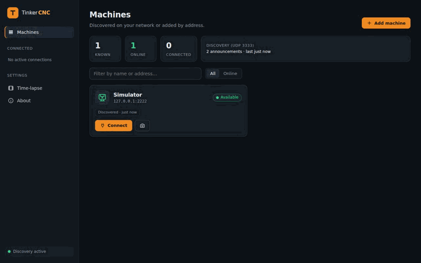
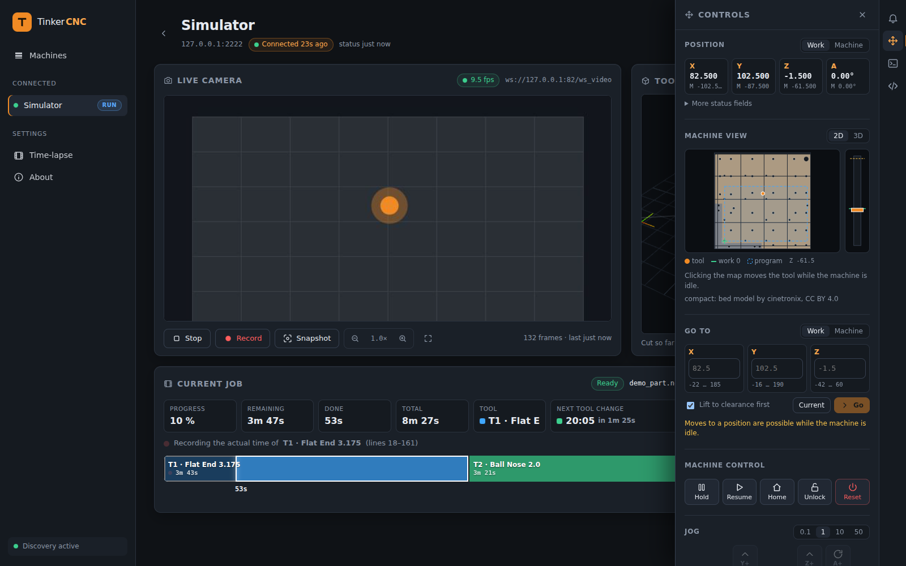
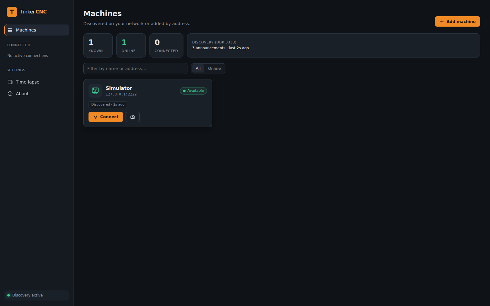

<p align="center">
  
</p>

<h1 align="center">TinkerCNC</h1>

<p align="center">
  <b>Open-source desktop app, web dashboard and G-code sender for the Makera Z1 and Z1 Pro.</b>*<br>
  Find your machine on the network, jog and probe, start jobs with the right options, watch the camera,
  and know when the next tool change is due.
</p>

<p align="center">
  <a href="https://github.com/TinkerDojo/TinkerCNC/actions/workflows/ci.yml"></a>
  <a href="https://github.com/TinkerDojo/TinkerCNC/releases/latest"></a>
  <a href="LICENSE"></a>
  
  
</p>

> \* TinkerCNC is an independent community project. It is not affiliated with, endorsed by or supported by
> Makera. "Makera" and "Z1" are trademarks of their owner and appear in this README only to say which machine
> TinkerCNC is made for. See [Compatibility](#compatibility) and [License and trademarks](#license-and-trademarks).



## Why TinkerCNC

- **Runs where you are.** Windows and macOS installers with automatic updates, or `dotnet run` on any computer
  (a Linux box next to the machine, for instance) and open the dashboard from any browser or tablet on your network.
- **Knows your job.** Estimated *and measured* operation times, a tool timeline, the predicted clock time of the next
  tool change, the toolpath drawn in the machine where it really cuts (live, or the whole job as a preview), and
  notifications for manual tool changes and alarms even when no browser tab is open, also as system notifications.
- **Starts jobs properly.** Pick a program (one of a setup's files, on the machine, or dropped in from this
  computer), choose the work origin, XYZ corner probing, auto Z probe, auto leveling, scan margin and the machine's
  own job modes, and read what starting will do, step by step, with the exact commands, before pressing Start. A job
  that ended early starts again from the tool operation it was in.
- **Runs batches.** A setup keeps the options once and any number of files, one per piece. Queue them and the
  machine runs them one after the other, each waiting for the go at the machine's own button, so the laptop can
  stay where it is. Every job you start is the queue's first, so "five more of these" is one number away.
- **Picks up where it stopped.** After an emergency stop, an alarm or a power cut, also after closing the app, a job
  resumes at the line it had reached: work origin restored, tool measured again, the head brought back to that point.
- **Speaks your language.** English, German, French and Italian, following the browser or the system.
- **Keeps the shop running.** Live camera shared by every viewer, snapshots and recordings, a time-lapse of every job
  you ask for, time-lapse playback,
  and bed cleaning that pauses a running job, sweeps, and resumes it.
- **Familiar if you have used a G-code sender** such as UGS, Candle or bCNC: TinkerCNC plays that role for the Z1,
  with the machine-specific parts (framed protocol, probing automation, job modes, spindle blower, camera) built in.
- **Made to be hacked on.** A clean C# protocol library (also on NuGet), host services without any UI, a CLI, a
  full machine simulator and a test suite: everything can be developed and tested without hardware.

## Features

| Area | What you get |
|---|---|
| Machines | UDP discovery with online/busy state, machines added by address, one shared connection per machine for every browser tab |
| Control | Positions (X/Y/Z/A, work and machine), hold / resume / home / unlock / reset, jog, go-to with travel checks, console with history, alarm banner |
| Machine views | Top view (tool, work origin, bed corner, program area, target), side view, 3D view with the Z1's bed as a model; heights of the tool's tip with the tool length offset taken out |
| Toolpath | 3D toolpath coloured by tool, drawn in the machine at the work origin with the stock under it; Live (cut so far) and Preview (the whole job) |
| Air | The Z1's spindle blower on/off, and bed cleaning in 1–3 passes that pauses and resumes a running job |
| Start a job | Programs from this computer (drag and drop), the machine's SD card or a setup's files; work origin, XYZ probe block, auto Z probe, auto leveling, scan margin, job modes, time-lapse recording; a step-by-step summary and the commands before starting; start from any tool operation, e.g. to take up a job that ended early |
| Setups | Named start options with notes and any number of G-code files, a Setups page to manage them, replacing files, soft delete and restore, run counts |
| Job queue | Files queued per machine with a setup's options and repeat counts; a job started on the Job card is the queue's first entry, its repeats can be raised while it runs; every further job waits for the go (the machine's button or Resume) before it moves; failures stop the queue with a retry from the interrupted tool operation; unchanged files are not uploaded again (MD5) |
| Resume | Where a running job is gets stored per machine (every 30 s, and at once when it ends early); after an E-stop, alarm or power cut it resumes at that line, also after reopening the app |
| Running job | Running file detection (also for jobs started on the machine), download cache by MD5, per-line time estimate, progress and remaining time scaled by the feed override |
| Tool timeline | One bar per tool operation, probing segment, cursor, predicted tool-change times, measured times replacing estimates after the first run |
| Notifications | Manual tool changes to confirm (`M490.2`), alarms and the queue's go, collected server-side; optionally as the system's own notifications |
| Languages | English, German, French and Italian, from the browser's or system's language or chosen under Settings |
| Camera | Live MJPEG from the machine's camera, snapshots, MP4 recordings (H.264 encoded in-process, no ffmpeg), one-frame-a-second time-lapses of jobs that play 30× faster, time-lapse playback with seek |
| Desktop app | Own window (WebView2 / WebKit), per-user install without admin rights, in-app updates via Velopack |
| Developer tools | `TinkerCNC.Core` library, `tinkercnc-cli`, machine simulator with camera and time-lapse, 226 tests |

The complete feature reference is in [`docs/features.md`](docs/features.md).



## Quick start

### Installer (Windows, macOS)

Download `TinkerCNC-win-x64-Setup.exe` or the macOS `.pkg` from the
[latest release](https://github.com/TinkerDojo/TinkerCNC/releases/latest) and run it. The app installs per user,
opens in its own window and updates itself from later releases. Unsigned builds make Windows SmartScreen warn once
and make macOS ask you to allow the app in System Settings (see [`docs/releases.md`](docs/releases.md)).

### From source (Windows, macOS, Linux)

Install the [.NET 10 SDK](https://dotnet.microsoft.com/download), then:

```sh
git clone https://github.com/TinkerDojo/TinkerCNC.git
cd tinkercnc
dotnet run --project src/TinkerCNC.Web          # dashboard at http://localhost:5185
```

To reach the dashboard from other devices on your network, start it with `--urls http://0.0.0.0:5185`. It has no
login and can move the machine, so do that only on a network you trust.

### Container (Linux server, Raspberry Pi)

```sh
docker run -d --name tinkercnc --network host -v tinkercnc-data:/data ghcr.io/tinkerdojo/tinkercnc:latest
```

Images for `linux/amd64` and `linux/arm64` are published with every release; [`compose.yaml`](compose.yaml) holds
the same setup. Host networking lets the container hear the machines' discovery broadcasts; with `-p 5185:5185`
instead, add machines by address. The dashboard then serves the whole network, and it has no login.

### Command line and library

```sh
dotnet tool install -g TinkerCNC.Cli       # tinkercnc-cli discover | query | connect | serial
dotnet add package TinkerCNC.Core          # the protocol library, for tools of your own
```

### Try it without a machine

```sh
dotnet run --project tools/TinkerCNC.Simulator -- --job     # a fake machine running a demo program
dotnet run --project src/TinkerCNC.Web                      # the dashboard finds it through discovery
```



## Compatibility

TinkerCNC is built for the **Makera Z1 and Z1 Pro**. It speaks the machine's framed control protocol over Wi-Fi/LAN
(TCP port 2222, UDP discovery on 3333) and over USB serial, and its WebSocket camera protocol, following the
open-source firmware the Z1 shares its command set with and what the machine itself reports.

| Machine | Status |
|---|---|
| Makera Z1 | Developed against it. Connecting, status, console commands and the air output have been checked on the machine; starting jobs with probing has so far only run against the bundled simulator. |
| Makera Z1 Pro | Expected to work like the Z1 (same firmware line and protocol); not yet tried on one. A [machine test report](../../issues/new?template=machine_report.yml) from a Z1 Pro would be very welcome. |

Not implemented yet: the native USB transport and compressed (`.lz`) uploads. Open points are listed in
[`docs/protocol.md`](docs/protocol.md#limitations-and-open-questions).

**Safety.** TinkerCNC controls machine tools. Check every program, origin and setting before running it, keep the
emergency stop within reach, and expect the time estimates to differ from the machine. The software comes with no
warranty; you use it at your own risk.

## How it is built

```
src/TinkerCNC.Core         protocol library: discovery, transports, packet framing, typed messages + visitors,
                           G-code analysis, video clients, storage (SQLite)
src/TinkerCNC.Host         machine services shared by every front end: sessions, jobs, notifications, camera
src/TinkerCNC.Web          Blazor Server dashboard, desktop window and updates; builds TinkerCNC.exe / TinkerCNC
src/TinkerCNC.Cli          tinkercnc-cli: discovery, query, interactive console over LAN or serial
tools/TinkerCNC.Simulator  a machine for development: discovery, control protocol, SD card, camera, time-lapse
tests/TinkerCNC.Tests      xUnit tests (protocol, jobs, motion, storage, host services)
build/                     installer scripts (Velopack) and the icon generator
```

Machine logic lives in `TinkerCNC.Host` and `TinkerCNC.Core`; the UI only renders and forwards. Sequences that must
outlive a browser tab (bed cleaning, job start, operation timing, notifications) run in the host services. Messages
are typed records dispatched through visitors, so adding a packet type never touches a `switch`.

- [`docs/development.md`](docs/development.md) — building, tests, simulator, CLI, using the library
- [`docs/protocol.md`](docs/protocol.md) — discovery, framing, file transfer, job start, probing, video
- [`docs/features.md`](docs/features.md) — what every panel does, data folder and settings
- [`docs/releases.md`](docs/releases.md) — installers, updates, signing, the release workflow
- [`CONTRIBUTING.md`](CONTRIBUTING.md) — how to contribute, coding rules

## Related projects

- [Carvera Community Controller](https://github.com/Carvera-Community/Carvera_Controller) — the community's
  controller for Makera's machines (Python, GPL-2.0), with initial Z1 support since version 2.2.0. TinkerCNC is a
  from-scratch .NET implementation that focuses on a browser dashboard, job timing and multi-device access; both
  can coexist on the same network.
- [CarveraFirmware](https://github.com/MakeraInc/CarveraFirmware) — Makera's open-source machine firmware (GPL-3.0, a
  [Smoothieware](https://github.com/Smoothieware/Smoothieware) branch), which the Z1 shares its command set with; the
  primary reference for the protocol notes in `docs/protocol.md`. TinkerCNC contains no code from it.

## Roadmap

Ideas rather than promises; pick one up if you like:

- confirmation from Z1 Pro owners that everything behaves the same
- native USB transport and compressed (`.lz`) uploads
- a login for the dashboard, so it can safely be opened to a whole network
- Linux desktop packaging (AppImage / Flatpak) next to the container image
- more machine views and probing wizards, and an MQTT / Home Assistant bridge

## Contributing

Issues, machine test reports and pull requests are welcome. Please read [`CONTRIBUTING.md`](CONTRIBUTING.md): it
explains the sign-off every commit needs (Developer Certificate of Origin) and the coding rules. Everything can be
developed and tested against the simulator; CI runs the tests on Windows, macOS and Linux.

## License and trademarks

Copyright 2026 TinkerDojo and the TinkerCNC contributors. Licensed under the
[Apache License 2.0](LICENSE); see [`NOTICE`](NOTICE) and [`THIRD-PARTY-NOTICES.md`](THIRD-PARTY-NOTICES.md) for
the components it includes.

"TinkerCNC" and "TinkerDojo" and the TinkerCNC logo are trademarks of TinkerDojo and are not covered by the license;
forks must use another name and logo ([`COPYRIGHT.md`](COPYRIGHT.md)). Other product names are trademarks of their
respective owners and are used only to identify the machines this software works with. TinkerCNC is not affiliated
with, endorsed by or supported by any machine manufacturer.
